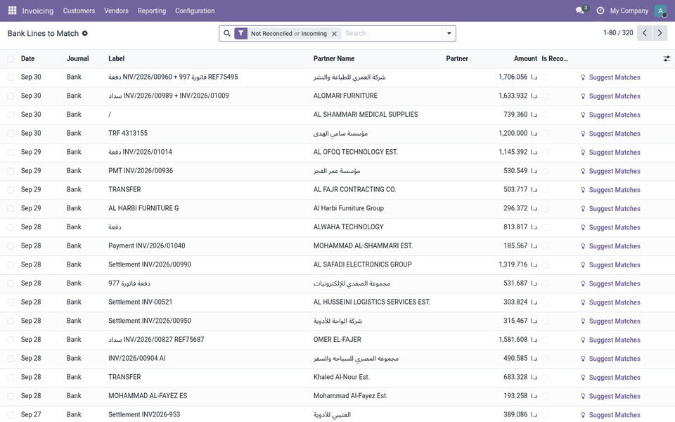
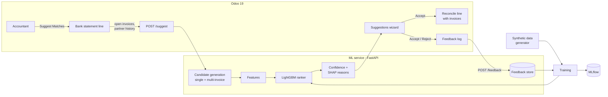
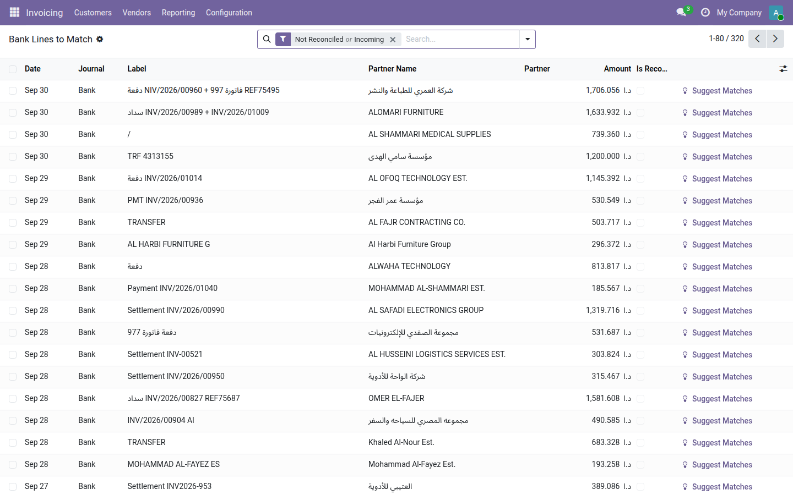
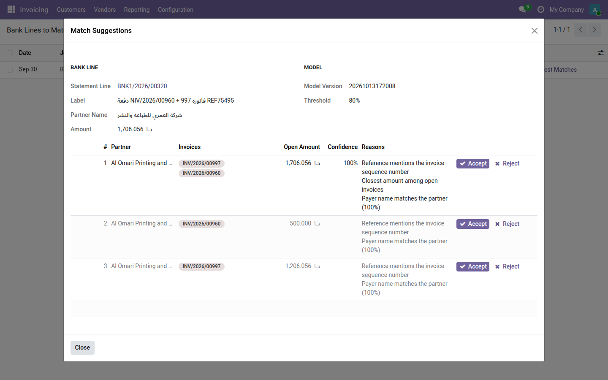
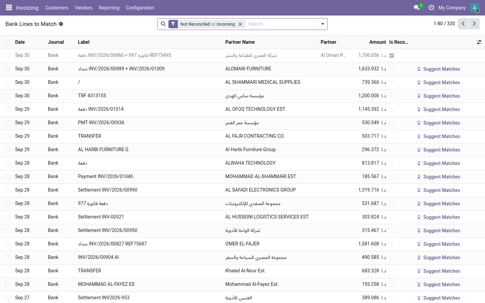
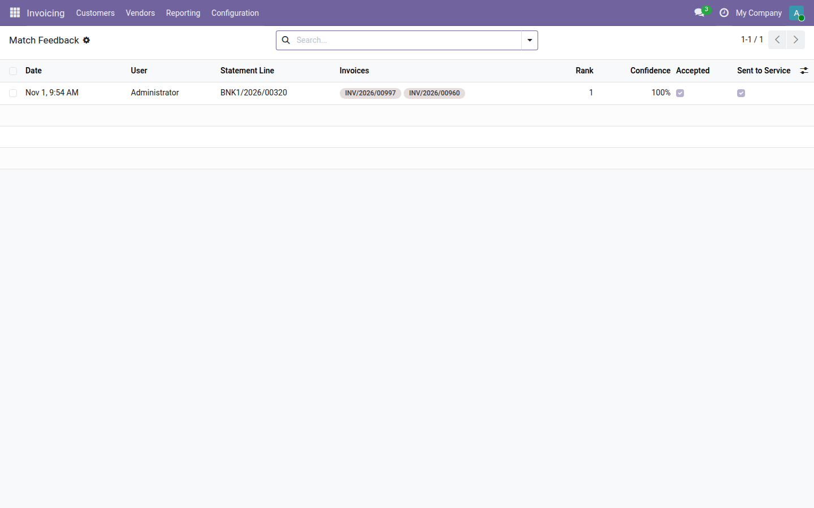

# Smart Bank Reconciliation

A learned ranking model for **Odoo 19** that suggests which customer invoice(s) an incoming bank statement line
pays. Each suggestion shows a confidence score and plain-language reasons. The model handles missing or messy
references, partial payments, grouped payments (one transfer for several invoices), and partner names written
in Arabic, English, or a varied Latin spelling of an Arabic name.

> **Branch `19.0`: Odoo 19 version.** The Odoo 20 version is on `main`. The ML service, data and model are the
> same; only the Odoo module differs. Changes from 20 to 19: access rights back to `ir.model.access.csv` plus an
> `ir.rule`, `get_param` instead of `get_str` / `get_float`, Font Awesome button icons, and the `odoo:19.0` image.
> Verified on Odoo 19.0 Community: all 11 module tests pass, and the end-to-end check gives the same result as on
> Odoo 20 (Top-1 95.0%, Top-3 98.7%, 99.3% precision above the threshold).



*In the demo above, the bank line reads "دفعة NIV/2026/00960 + فاتورة 997 REF75495" from
"شركة العمري للطباعة والنشر". It has a typo in the first invoice number ("NIV"), the second invoice written as
"invoice 997" in Arabic, and an Arabic payer name. The model suggests the right two invoices together, with its
reasons.*

## Why

Accountants match bank lines to invoices by hand when the payer leaves no usable reference, pays part of an
invoice, pays several invoices in one transfer, or appears under a different name. In Jordan and Saudi Arabia
the bank often prints the payer's Arabic name, or a transliteration of it, while the invoice uses the English
name ("شركة النور للتجارة" vs "Al Nour Trading Co." vs "ALNOOR TRADING").

## Results

Measured on synthetic data (see [Limitations](#limitations)). The test set is the last 4 of 24 months, so the
model never sees later data during training.

| Test set, 1,700 matched lines | Top-1 | Top-3 | MRR |
|---|---|---|---|
| Rule-based baseline | 92.9% | 95.1% | 0.946 |
| **LightGBM ranker** | **96.6%** | **99.1%** | **0.978** |

| Line type | Lines | Baseline Top-1 | Model Top-1 |
|---|---|---|---|
| Single invoice, full payment | 1,121 | 97.8% | 98.8% |
| Partial payment | 485 | 80.4% | 90.9% |
| Grouped payment (2–4 invoices) | 94 | 98.9% | 100% |

- **Confidence:** with a threshold of 0.8, 88.4% of all test lines (unmatched lines included) get a confident
  suggestion, and 98.9% of those are correct.
- **Candidate recall:** the correct invoice set is among the generated candidates for 99.5% of matched lines.
  The remaining 0.5% cannot be found by any ranking.
- **End to end through Odoo:** 320 bank lines were loaded into an Odoo 19 database and sent through the
  module and the live service, one by one, as a user would. Result: Top-1 95.0%, Top-3 98.7%. 281 of 320 lines
  were above the threshold, with 99.3% precision. The small drop from the offline result is expected: the demo
  database has no payment history, so the partner-timing feature is missing.

*Top-1:* the right invoice set is the first suggestion. *Top-3:* it is in the first three. *MRR (Mean
Reciprocal Rank):* 1 / position of the right answer, averaged.

What the model relies on most (LightGBM gain): how much better this candidate's name match is than the other
candidates' (`name_sim_gap`), whether the reference contains the invoice sequence number, the amount ratio, and
whether the reference mentions invoices that the candidate does not include.

## How it compares with native Odoo

- **Odoo 19 Community** has no bank reconciliation screen and no matching suggestions. This module adds both.
- **Odoo Enterprise** has reconciliation models: rules that you configure, which match on amount, partner and
  label. The baseline in this project is a rule set in that spirit (reference, amount, name), written for this
  project. It is **not** Odoo's own engine, and the comparison above is not a measurement of Odoo Enterprise.
- What this project adds: a ranking learned from data, with a measured accuracy; a calibrated confidence;
  multi-invoice suggestions; Arabic/English name matching; reasons for each suggestion; and a feedback loop
  for retraining.

## Architecture



1. **Candidate generation** ([matching.py](ml/src/smart_reconcile_ml/matching.py)): up to 25 single invoices,
   chosen by quick score, plus up to 15 multi-invoice sets. These are subsets of 2–4 open invoices of a likely
   partner whose total fits the amount within a fee tolerance.
2. **Features:** amount difference and ratio, fee-like shortfall, partial-payment flag, days since invoice and
   due date, deviation from the partner's usual payment delay, reference match (exact number, sequence number,
   fuzzy), payer-name similarity, and relative features within the line (name gap, amount rank).
3. **Name matching** ([text.py](ml/src/smart_reconcile_ml/text.py)): Arabic letter normalization (أ/إ/ا, ة/ه,
   ى/ي, Arabic digits), removal of legal-form words, a small glossary of business words (للتجارة → trading),
   and a consonant "skeleton" that makes النور, Al-Nour and Alnoor compare as equal.
4. **Ranking:** LightGBM `lambdarank`, with early stopping on the validation months.
5. **Confidence:** logistic regression on the top score and its margin over the second, fitted on validation
   lines including lines with no match.
6. **Reasons:** LightGBM SHAP contributions (`pred_contrib`) select the features that pushed a suggestion up.
   They are shown as plain sentences, for example "Reference mentions the invoice sequence number".
7. **Feedback:** the service stores each request's candidate features. Accept or reject in Odoo is logged and
   sent to `/feedback`; if the service is down, a cron job retries. `train --feedback` adds accepted
   suggestions as extra training groups.

### Screens

| Bank lines to match | Suggestions with confidence and reasons |
|---|---|
|  |  |
| **After Accept: the line is reconciled** | **Feedback log (sent to the service for retraining)** |
|  |  |

The screenshots are taken automatically from the Docker demo: `make reset-demo && make screenshots`.

### Odoo module (`addons/smart_reconcile`)
- *Customers → Smart Reconciliation → Bank Lines to Match*: unreconciled incoming lines with a
  **Suggest Matches** button.
- Suggestions wizard: rank, partner, invoices, open amount, confidence bar, reasons, **Accept** / **Reject**.
  Suggestions below the threshold are greyed out.
- **Accept** replaces the line's suspense entry with one receivable entry per invoice and reconciles them. A
  partial payment leaves the invoice partly open. An overpayment leaves the rest on the suspense account.
- **Who can accept:** Invoicing users. Changing a bank line's journal items normally needs Odoo's "Basic"
  accounting group, which Community admins often lack. So the module checks the Invoicing right explicitly, then
  runs only the reconciliation with elevated rights. A test runs this as a real Invoicing user.
- *Alternative Name* field on partners (for example the Arabic name), sent to the model with the main name.
- Settings: service URL and confidence threshold. Calls time out after 10 seconds. If the service is down, the
  user gets a clear message and can still reconcile manually.

## Data

All data is synthetic, produced by [generator.py](ml/src/smart_reconcile_ml/generator.py) from a fixed seed.
See [docs/data-spec.md](docs/data-spec.md) for the specification and [docs/data-report.md](docs/data-report.md)
for statistics. No real company, client or bank data is used.

## Run it

### With Docker
```bash
make demo      # builds images (trains the model, ~3–5 min), creates database "demo", loads synthetic data
```
- Odoo: http://localhost:8069 (admin / admin) → *Customers → Smart Reconciliation*
- ML service docs: http://localhost:8000/docs
- MLflow: http://localhost:5000

Other targets: `make e2e` (end-to-end check), `make retrain` (retrain with collected feedback), `make down`.

### Without Docker
```bash
cd ml
python -m venv .venv && . .venv/bin/activate
pip install -e ".[dev,mlflow]"
python -m smart_reconcile_ml.generator --out data/generated/v1
python -m smart_reconcile_ml.train --data data/generated/v1 --out models/latest
uvicorn smart_reconcile_ml.service:app --port 8000
```
Then add `addons/` to an Odoo 19 addons path, install *Smart Bank Reconciliation*, and set the service URL to
`http://localhost:8000` in settings. To load demo data: `python -m smart_reconcile_ml.export_demo`, then
`DEMO_JSON=<path> odoo-bin shell -d <db> < scripts/load_demo_data.py`.

### Tests
```bash
cd ml && pytest                                   # 21 tests: text matching, generator, model, service
odoo-bin -d test -i smart_reconcile --test-tags /smart_reconcile --stop-after-init   # 9 Odoo tests
```

## Limitations

- **Synthetic data.** The accuracy figures come from data produced by my own generator. The noise rules
  (typos, name variants, fees, look-alike amounts) are guesses about real bank data. Real-world accuracy will be
  lower and must be measured on real statements before anyone relies on it.
- **The model leans on name matching.** That works when the bank shows the payer's name. It is weaker when a
  third party pays (3% of synthetic lines).
- Customer invoices and incoming payments only, in the company currency. No vendor bills, no multi-currency.
- A bank fee is not written off. The last matched invoice stays partly open by the fee amount.
- Multi-invoice candidates are limited to one partner and at most 4 invoices.
- The feedback loop is implemented and tested, but its effect on accuracy has not been measured, because that
  needs real user feedback.
- Nothing is posted automatically. A person accepts every match.

## Repository layout

| Path | Contents |
|---|---|
| `addons/smart_reconcile/` | Odoo 19 module (LGPL-3) |
| `ml/src/smart_reconcile_ml/` | Generator, features, training, model, FastAPI service |
| `ml/tests/` | pytest suite |
| `scripts/` | Odoo shell scripts: load demo data, end-to-end check |
| `docs/` | Data specification and data report |

## License

LGPL-3.0. See [LICENSE](LICENSE).
